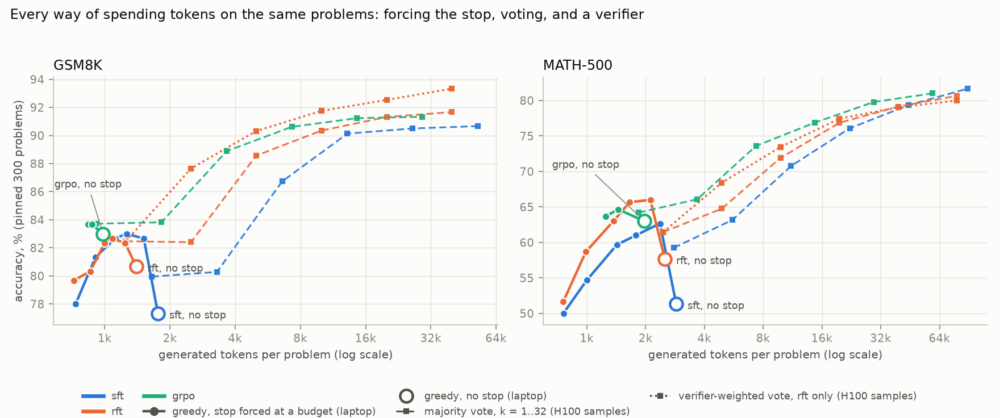

# reasoning-rlvr: where does post-training gain come from?

A controlled study of the reasoning post-training recipe on one small base model. Starting from
Qwen3-1.7B-Base, each stage (SFT on distilled traces, rejection-sampling fine-tuning, GRPO with a
verifiable reward) is trained at a stated compute budget and scored the same way: greedy, paired on
shared problems, 95 % bootstrap confidence intervals, a hypothesis and falsifier written before each
run, three contamination probes, a seed-noise row, and a compute ledger. The question is not "does
the recipe work" but **what each stage buys, and whether what it buys is reasoning, sharpening, or
something cheaper**.

About 55 H100-hours and 11 L4-hours of rented compute (USD 260, under the USD 262 ceiling) and about
40 laptop GPU-hours, 14-24 Oct 2026. Checkpoints and every sample:
[`Raviteja546`](https://huggingface.co/Raviteja546) on Hugging Face.

## The answer, in five findings

Each finding cites its claim in the evidence index (`outputs/reports/evidence/`), which re-derives
the number from the per-sample files and lists the problems behind it.

1. **The on-policy gains are termination.** Every stage beats the one before it in the format it was
   trained in, with CIs clear of zero. Decomposed per problem, the whole paired gain of RFT and of
   GRPO sits on problems the previous policy did not finish; on problems both finished, accuracy does
   not move (GRPO over RFT, MATH-500: +10.2 [7.4, 13.2] on the truncated problems, 0.0 [-4.3, 3.9] on
   the both-finished ones; P3-04, P4-02).
2. **A decoding rule buys the same thing for free.** Appending `</think><answer>` at a token budget
   lifts the SFT checkpoint by +4.6 [3.4, 6.0] / +7.2 [4.0, 10.4] (GSM8K / MATH-500) at 1,536 tokens,
   more than RFT's whole gain and three quarters of GRPO's, on the same machine (P5-08). With RFT and
   GRPO both stopped at 2,048 tokens, GRPO's MATH-500 gain over RFT is gone: -0.4 [-4.4, 3.4] (P5-16).
3. **Votes and a small verifier reach the RL policy's number.** Majority vote over two RFT samples
   matches the GRPO policy's greedy accuracy at 2.6x the tokens, four beat it (P5-01, P5-02); with a
   0.6B verifier trained on the laptop, the better of two RFT samples beats it by +3.0 [0.1, 6.0] /
   +4.0 [0.2, 7.7] (P5-13). As k grows, the verifier's arg-max is over-optimised (best-of-32 is 12-13
   points below majority-of-32 on MATH-500, P5-14); its scores used as vote weights are not.
4. **A loop is one step repeated from a fixed point.** 96-99 % of truncated GSM8K completions contain
   a recurring 50-word window; the repeated unit is a 100-190-word step starting near word 500 (GSM8K)
   or 800 (MATH-500) whatever the window, so more room adds cycles, not progress. Training changed how
   often a loop happens, not what it is (Kolmogorov-Smirnov distance SFT against GRPO 0.11-0.16; P6-01).
5. **Greedy decoding is reproducible per machine, not across GPUs, and that changed a verdict.** The
   same checkpoint decoded on an H100 and on the laptop flips 10-23 % of problems (P5-10, P5-18). Paired
   across machines, GRPO under the stop rule read as "no gain" (+0.2); paired on one machine it is +2.0
   [0.6, 3.6] on MATH-500 (P5-11).

Against the base model's own best prompt (zero-shot), the three stages add +6 on GSM8K and +11 on
MATH-500, so the pipeline did add something a user could not get for free. **At 1.7B and about one
GPU-day per method, on-policy post-training in the trained format taught the model to stop looping and
answer, and little else;** a stop rule, two votes or a small verifier recover most of it.

## The one table

Qwen3-1.7B-Base, greedy, think-tag format (the format the RL stages train in), 4,096-token window.
Each gain is paired against the row's reference on shared problems. "On truncated" is the part of the
gain on problems the reference did not finish; "both finished" is the paired difference on problems
both answered (`scripts/decompose_gain.py`). Rows 1-6 ran on the H100, rows 7-8 on the laptop, each
against a reference decoded on the same machine.

| row | GSM8K gain | on truncated | both finished | MATH-500 gain | on truncated | both finished |
|---|---|---|---|---|---|---|
| 1. base, think-tag (accuracy) | 61.8 | | | 44.8 | | |
| 2. SFT, 23k distilled traces, vs base (EXP-006) | +13.0 [10.0, 15.8] | not split | | +5.8 [0.6, 11.0] | not split | |
| 3. RFT, one round of selection, vs SFT (EXP-010) | +3.3 [1.0, 5.8] | +6.9 [5.2, 8.6] | -0.8 [-2.5, 0.9] | +5.8 [1.6, 10.2] | +12.2 [8.8, 15.6] | -2.5 [-7.0, 1.5] |
| 4. GRPO, 200 steps, vs RFT (EXP-012) | +4.1 [2.0, 6.1] | +4.2 [3.0, 5.5] | +1.1 [-0.6, 2.8] | +7.0 [2.8, 11.0] | +10.2 [7.4, 13.2] | 0.0 [-4.3, 3.9] |
| 5. GRPO, KL off, vs GRPO (EXP-014a) | +2.2 [0.4, 4.0] | +2.0 [1.3, 2.7] | +1.0 [-0.7, 2.7] | +5.6 [1.6, 9.4] | +5.4 [3.4, 7.6] | +2.7 [-1.3, 6.5] |
| 6. GRPO, 2,048 cap, vs GRPO (EXP-015) | +0.2 [-1.7, 2.2] | +2.4 [1.6, 3.3] | +1.1 [-0.6, 2.9] | -2.6 [-6.4, 1.2] | +3.2 [1.6, 4.8] | +1.2 [-3.0, 5.2] |
| 7. SFT with the stop forced at 1,536, vs SFT (EXP-016) | +4.6 [3.4, 6.0] | +4.7 [3.4, 6.0] | -0.1 [-0.3, 0.0] | +7.2 [4.0, 10.4] | +8.8 [6.0, 11.6] | -2.7 [-5.4, -0.4] |
| 8. GRPO vs RFT, both stopped at 2,048 (EXP-020) | +1.6 [-0.4, 3.6] | | | -0.4 [-4.4, 3.4] | | |
| final GRPO, think-tag / zero-shot (accuracy) | 82.3 / 84.3 (base zero-shot 77.9) | | | 63.4 / 64.4 (base zero-shot 53.8) | | |

Three facts make the decomposition a conclusion rather than a correlation. The truncated generations
are loops, not slow solutions: at an 8,192-token cap they still do not finish (EXP-010c). Half of
RFT's stopping effect on GSM8K is the length filter itself: two random correct traces per problem
instead of the two shortest cost 2.4 [0.1, 4.7] points (EXP-010h). And the GRPO seed repeat lands 4.8
points lower on MATH-500 for the same reason, more truncations, with no difference among finished
answers (EXP-013); 4.8 is the project's noise row on MATH-500.

## The one chart



Every way of spending tokens on the same 300 problems per set: greedy with the stop forced at a
budget (solid, laptop), the unforced greedy run ("no stop"), majority vote over k samples (dashed,
H100 samples), and the verifier-weighted vote over RFT's samples (dotted). The table with CIs:
`outputs/reports/figures/final-accuracy-vs-tokens.md`.

## What failed

Each was a prediction written before its run (`experiments.md`); the entry says what it changed.

- **Determinism (EXP-000).** Three identical greedy evals differed by up to 6 points under vLLM's
  default scheduler; batch-invariant mode fixed it on one machine.
- **The machine term (EXP-020b).** Predicted under 2 % of problems flipping across GPUs; measured
  10-23 %. Every comparison against an unforced checkpoint was re-paired on one machine, which
  reversed EXP-020a's first reading and shrank EXP-016's first-quoted gain (+5.8 / +9.0 to +4.6 / +7.2).
- **The noise row (EXP-013).** Predicted under 3 points seed-to-seed on MATH-500; measured 4.8.
- **Countdown (EXP-012).** Predicted flat; it doubled, and decomposed as termination.
- **KL off (EXP-014a).** Predicted within noise; it landed above the main run, by termination.
- **Dynamic sampling and the cap (EXP-014b, 015).** Both falsifiers fired: neither changed anything
  on the problems both policies finish.
- **The unfiltered RFT set (EXP-010g).** No power by construction (93 % of its traces were correct).
- **Forced answers (EXP-016, 020a).** Predicted to be right as often as finished ones; they are right
  about half the time for SFT and RFT, 17-22 % for GRPO.
- **The verifier at k = 4 (EXP-022).** Predicted to beat majority vote by 1-3 points on MATH-500; it
  did not; its arg-max collapses at k = 32.
- **Loop onset (EXP-023).** Predicted late in the budget; loops start early, at a fixed position.

Every incident that changed a number, and its fix, is in `FAILURES_AND_LEARNINGS.md` (indexed).

## What every number carries

- **Paired comparisons with CIs**, per problem on shared ids, 95 % bootstrap over problems; a
  difference whose CI covers zero is reported as such; pairs only within one machine.
- **A deterministic harness** (`rlvr-eval`, batch-invariant vLLM, unit-tested extraction); its 4-shot
  CoT rows reproduce the Qwen3 technical report within 1-2 points (EXP-001).
- **Pre-registration**: hypothesis, metric and falsifier in `experiments.md` before each run (36
  entries, indexed); the chain of questions in `docs/research-narrative.md`.
- **Controls that cost compute**: token- and step-matched SFT controls, a cap experiment, an
  unfiltered and a random-selection RFT set, a seed repeat, same-machine controls for every
  cross-machine pair. One design error is recorded where its number is quoted: the Phase 3 controls
  trained on data SFT had already seen.
- **Three contamination probes** on the base model and after every stage: 13-gram and fuzzy overlap,
  a perturbed GSM8K twin with a names-only control, partial-prompt completion. No stage added a
  memorisation signal.
- **From-scratch references checked against the library**: the GRPO loss (three aggregations), group
  advantages, k1/k2/k3 KL, unbiased pass@k, the SFT loss, a sampler (`src/rlvr/ref/`, tested); the
  TRL + vLLM trainer matches the reference loss to 1e-9 and its gradients to 1.4e-5 in fp32.
- **A reward-hacking watch** on every RL run (length without accuracy, format-only outputs, groups
  agreeing on a wrong answer, "wait" spam, rising truncation); no flag fired.
- **An evidence index**: 51 quoted claims, 47 with a number, each re-derived from the per-sample files
  with the problems and excerpts behind it; every one agrees (`docs/evidence-index.md`).
- **A compute ledger** (`COMPUTE.md`): every run's GPU-hours, tokens and cost.
- **Reproducibility**: a run is a config plus a commit; a preflight checks configs, prompt files and
  eval subsets against pinned hashes; the harness refuses a dirty tree; CI runs the CPU tests on every
  push, and `scripts/ci_local.sh` runs CI's commands locally before a PR.

## What comes next

The result is a property of the method at this scale, data and budget, and the experiment that could
change it is pre-registered and unrun for budget: **GRPO on harder prompts** (MATH levels 3-5,
EXP-018), where problems the policy finishes but gets wrong are common enough for the reward to teach
something other than stopping. With ten times the compute: that run with two seeds, Dr. GRPO's loss
normalisation (EXP-014c), and a matched-incorrect RFT set (EXP-010i). Not worth it at any compute:
more steps of the same GRPO configuration, which plateaued by step 50.

## Reproduce

```bash
# Linux or WSL2 with a CUDA GPU and uv; the Hub repos are public, no token needed.
# Clones the repo, builds a fresh venv, reruns the four Qwen3-1.7B-Base greedy configs (about 0.8
# GPU-hours on an RTX 4060), and pairs every completion with the archived run (EXP-024).
curl -sSLO https://raw.githubusercontent.com/rrtchaganti/reasoning-rlvr/main/scripts/reproduce_baselines.sh
bash reproduce_baselines.sh
```

Development setup: `bash scripts/setup_env.sh` (uv, Python 3.12, the locked vLLM, TRL and dev tools),
then `bash scripts/check.sh` (ruff and the CPU tests). The rented-GPU sessions are
`scripts/phase{1,2,3,4}_rental.sh`, each step resumable, with `docs/rental-setup.md` as the procedure.
The decoding on another GPU will differ from ours on some problems (finding 5); the CIs, not the
digits, are what should agree.

## Status

| phase | state | report |
|---|---|---|
| 0 Harness, from-scratch references | merged 14 Oct 2026, tag `phase-0` | [`phase-0.md`](outputs/reports/phase-0.md) |
| 1 Baselines, pass@k ceiling, contamination probes | merged 14 Oct, tag `phase-1` | [`phase-1.md`](outputs/reports/phase-1.md) |
| 2 SFT on distilled traces | merged 20 Oct, tag `phase-2` | [`phase-2.md`](outputs/reports/phase-2.md) |
| 3 Rejection-sampling fine-tuning | merged 20 Oct (PR #4), tag `phase-3` | [`phase-3.md`](outputs/reports/phase-3.md) |
| 4 GRPO and ablations | merged 21 Oct (PR #5), tag `phase-4` | [`phase-4.md`](outputs/reports/phase-4.md) |
| 5 Test-time compute: the stop rule, votes, a verifier, the machine term | 5A merged 22 Oct (PR #6, tag `phase-5`); 5B merged 24 Oct (PR #8, tag `phase-5b`) | [`phase-5.md`](outputs/reports/phase-5.md) |
| 6 The traces | merged 24 Oct (PR #8, tag `phase-6`) | [`phase-6.md`](outputs/reports/phase-6.md) |
| 7 Write-up, interview packet, reproduction check | this branch | [`docs/phase-7-plan.md`](docs/phase-7-plan.md) |

Deliverables of `PLAN.md` section 1:

| | deliverable | state |
|---|---|---|
| D1 | the evaluation harness `rlvr-eval` | done |
| D2 | base-model baseline report | done (`phase-1.md`) |
| D3 | contamination and memorisation report | done (Phase 1, then after every stage) |
| D4 | four checkpoints on Hugging Face | three of four: `sft`, `rft`, `grpo` with cards; `distilled-0.6b` dropped |
| D5 | GRPO ablations with a seed-noise row | two of three ablations plus the cap test in the third's slot (EXP-014a, 014b, 015); Dr. GRPO deferred |
| D6 | the test-time-compute chart | done (the chart above) |
| D7 | distillation and serving table | dropped |
| D8 | from-scratch references with tests | done (`src/rlvr/ref/`) |
| D9 | write-up | README, `docs/results.md`, `FAILURES_AND_LEARNINGS.md`, the interview packet; the blog post paused |

The reasons for each drop are in `docs/plan-after-phase-4.md` section 4.

## Where things are

| where | what |
|---|---|
| [`docs/results.md`](docs/results.md) | the long form: the plan's ten questions answered, phase by phase, every result table |
| [`docs/research-narrative.md`](docs/research-narrative.md) | the chain of questions, with the predictions written before each run |
| [`experiments.md`](experiments.md) | pre-registration and result of every run, indexed |
| `outputs/reports/` | one report per phase, the paired tables and figures; `evidence/` the per-claim evidence |
| `src/rlvr/` | `eval/` the harness, `ref/` the from-scratch references, `train/` SFT, GRPO and the reward model, `data/` builders and probes |
| `scripts/` | session scripts (resumable), preflight, paired compares, the decomposition, the analyses and plots |
| `tests/` | about 220 CPU tests plus GPU-marked ones |
| [`COMPUTE.md`](COMPUTE.md), [`FAILURES_AND_LEARNINGS.md`](FAILURES_AND_LEARNINGS.md) | the ledger and the incident log |
| `docs/` | per-phase engineering notes and journals, plans, rental procedure, background ([`METHODS_AND_METRICS.md`](METHODS_AND_METRICS.md), [`GLOSSARY.md`](GLOSSARY.md)) |
| `cards/` | the model cards |
