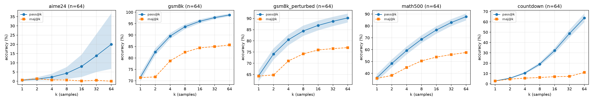

# Phase 1 report: base-model baselines and contamination probes

Branch `phase-1-baselines`, 14 Oct 2026. Local RTX 4060 (WSL2) for every number here; all runs at
commit `ffd3018` (greedy baselines, probe) and `585a586` (names-only control), batch-invariant vLLM,
seed 0, so every row regenerates bit-for-bit. Full tables: `phase-1-baselines.md` (same folder).
The n = 64 sampling (EXP-002, pass@k ceiling) ran on a rented L4 on 17 Oct 2026 for four of its five sets; section 7 (addendum) carries it. Its Countdown half runs in the Phase 2 A100 session.

## 1. Calibration against the Qwen3 technical report (EXP-001 falsifier)

| model | prompt | ours, GSM8K | report | ours, MATH-500 | report (full MATH) |
|---|---|---|---|---|---|
| Qwen3-1.7B-Base | 4-shot-CoT | 74.5 [72.0, 77.0] | 75.44 | 41.4 [37.0, 45.8] | 43.50 |
| Qwen3-0.6B-Base | 4-shot-CoT | 61.9 [59.3, 64.6] | 59.59 | 28.0 [24.0, 31.8] | 32.44 |

Both models land within the pre-registered tolerance (3 points on GSM8K, about 5 on MATH, where
MATH-500 is a subset). The harness and the 4-shot-CoT prompt are calibrated; later checkpoints are
compared to these rows.

## 2. Greedy baselines, four prompts x two models (pass@1 %, 95 % bootstrap CI over problems)

| model | prompt | GSM8K (1319) | GSM8K perturbed (830) | MATH-500 | Countdown (500) | AIME24 (30) |
|---|---|---|---|---|---|---|
| 1.7B | zero-shot (+ boxed instruction) | **77.6** [75.3, 79.9] | 70.0 [67.0, 73.1] | **53.6** [49.4, 57.6] | - | 3.3 |
| 1.7B | 4-shot, answer only | 20.5 [18.3, 22.6] | 13.6 | 17.4 [14.2, 20.8] | - | 3.3 |
| 1.7B | 4-shot-CoT | 74.5 [72.0, 77.0] | 67.8 [64.8, 71.1] | 41.4 [37.0, 45.8] | - | 0.0 |
| 1.7B | think-tag | 61.3 [58.7, 63.8] | 50.8 | 43.0 [38.8, 47.4] | 1.2 [0.4, 2.2] | 6.7 |
| 0.6B | zero-shot | **64.9** [62.3, 67.5] | 59.5 | **37.6** [33.4, 41.6] | - | 3.3 |
| 0.6B | 4-shot, answer only | 9.8 | 7.3 | 11.0 | - | 0.0 |
| 0.6B | 4-shot-CoT | 61.9 [59.3, 64.6] | 56.5 | 28.0 [24.0, 31.8] | - | 0.0 |
| 0.6B | think-tag | 38.7 | 33.7 | 33.6 | 2.0 [1.0, 3.4] | 0.0 |

Three things a reader should take from this table.

- **Zero-shot beats 4-shot-CoT on both models**, by 3 points on GSM8K and by 12 (1.7B) and 10 (0.6B)
  points on MATH-500. The zero-shot prompt is "Question/Problem ... put your final answer in
  \boxed{}. Answer:"; the base model then writes a long chain of thought on its own (248 tokens
  mean, versus 154 under the shots). Qwen3's base models have clearly seen instruction-style maths
  in pretraining, and the four Minerva shots pull the model toward terse solutions that are cut
  off or wrong more often. The 4-shot-CoT rows remain the comparability rows (that is what the
  report used); the zero-shot rows are the best-prompt baseline and will be tracked for every
  checkpoint as well.
- **Answer-only 4-shot collapses** (20.5 / 9.8 on GSM8K, 20 tokens per answer): without room to
  reason the base model guesses. This is the floor the chain-of-thought rows should be read against.
- **The think-tag prompt is the RL starting point and it is poor**: 36 % of GSM8K completions (1.7B)
  run to the 1024-token limit in repetition loops, Countdown is at 1-2 % with two thirds truncated,
  and the 0.6B base fails to produce the tag format on 12-34 % of problems. GRPO with a format
  reward has a lot to fix before it can improve accuracy, which is the point of Phase 4.

MATH-500 by level (1.7B, 4-shot-CoT): 67.4 / 64.4 / 51.4 / 35.2 / 15.7 for levels 1-5; zero-shot:
81.4 / 70.0 / 70.5 / 47.7 / 26.1. Level 5 is where the base model has the least and where a
"capability added" claim would have to show up (Q10).

Extraction health is in `phase-1-baselines.md`: 0 % extraction failures on GSM8K for every
chain-of-thought prompt; 10-21 % on MATH-500 (answers stated in prose without `\boxed{}`, counted
as failures, never as wrong); the last-number fallback produced 17 % of GSM8K answers under
4-shot-CoT, and an attempted "better" rule was rejected after it broke more than it fixed
(`FAILURES_AND_LEARNINGS.md`, 14 Oct).

## 3. Contamination and memorisation probes (EXP-003, EXP-003b)

### 3a. Perturbation gap: original minus perturbed GSM8K, paired on the same problems

Perturbed set: numbers resampled from [x/2, 2x] and names swapped, golds recomputed from the
calculator annotations and verified (830 of 1319 problems survive every check; manifest hash
`b5afb83e6aacafcf`). Paired bootstrap over the 830 matched pairs.

| model, prompt | original on pairs | perturbed | gap [paired CI] | flips orig-only / pert-only |
|---|---|---|---|---|
| 1.7B zero-shot | 80.7 | 70.0 | **10.7 [8.0, 13.6]** | 120 / 31 |
| 1.7B 4-shot-CoT | 78.0 | 67.8 | **10.1 [7.0, 13.3]** | 131 / 47 |
| 1.7B think-tag | 63.1 | 50.8 | 12.3 [8.7, 16.1] | 184 / 82 |
| 1.7B 4-shot answer-only | 19.6 | 13.6 | 6.0 [3.4, 8.6] | 91 / 41 |
| 0.6B zero-shot | 67.7 | 59.5 | 8.2 [5.2, 11.4] | 122 / 54 |
| 0.6B 4-shot-CoT | 65.3 | 56.5 | 8.8 [5.8, 11.9] | 122 / 49 |
| 0.6B think-tag | 38.6 | 33.7 | 4.8 [1.7, 8.0] | 116 / 76 |

The pre-registered falsifier (gap above 8 points) fired for every chain-of-thought prompt on the
1.7B model. Taken alone this would have meant "treat GSM8K as recall-contaminated".

### 3b. The names-only control (EXP-003b)

Same prompt, same model; names swapped, every number untouched, golds unchanged; 516 problems
with a swappable name.

| variant | pairs | original | variant | gap [paired CI] | flips |
|---|---|---|---|---|---|
| names only | 516 | 73.8 | 74.2 | **-0.4 [-3.3, 2.5]** | 28 / 30 |
| numbers + names, same problems | 371 | 77.4 | 66.6 | **10.8 [6.2, 15.4]** | 61 / 21 |

Swapping names does nothing; changing numbers costs ten points on the very same problems. The gap
is **arithmetic brittleness on resampled (on average larger) numbers, not recall of the problems'
surface form**. Consequences: GSM8K is not treated as memorised for this model; the perturbed set
stays the primary "reasoning, not recall" GSM8K metric for every later checkpoint (Q9), because a
checkpoint that reasons should close this gap and one that memorises training answers will not.
A side result: under a semantically null change, 11 % of problems still flip (28 one way, 30 the
other). That is the per-problem noise floor of greedy decoding on this model; single-problem
"wins" are not evidence of anything.

### 3c. Partial-prompt completion (first 60 % of the problem, greedy continuation)

| eval | problems | completed, similarity >= 0.9 [Wilson] | ... restricted to held-out parts of >= 12 words | chance (shuffled pairs) |
|---|---|---|---|---|
| GSM8K-test | 1319 | 2.1 % [1.5, 3.1] | 1.1 % [0.6, 1.9] (n = 1103) | 0 |
| MATH-500 | 491 | 16.3 % [13.3, 19.8] | 11.6 % [7.9, 16.7] (n = 207) | 0 |

Reading the hits by eye: on MATH-500 many are genuine (specific LaTeX reproduced exactly, e.g. the
full `\frac{\sin x}{\cos x}` expression or "positive integers and c is as small as possible, then
what is a+b+c?"); on GSM8K most hits reproduce the sentence structure with different numbers (28 ->
12 stickers, 2136 -> 2100 reports), i.e. template familiarity rather than memorised instances. The
pre-registered falsifier (above 5 %) fires for MATH-500 and not for GSM8K. MATH is a widely copied
dataset and this is the expected direction; the practical consequence is that MATH-500 gains in
later phases are read next to the level breakdown and the Countdown transfer, never alone.

### 3d. Training-data overlap

Deferred to Phase 2, when the first training files (GSM8K-train, MATH-train, filtered prompts)
exist; the probe (`rlvr.data.contamination`) is built and tested.

## 4. What this phase did not do

- EXP-002 (n = 64 sampling, pass@k and maj@k curves, the figure): not in the local part; done for four
  of five sets on 17 Oct 2026 (section 7), Countdown pending.
- No HF Hub uploads yet (nothing sampled at n = 64 to upload).

## 5. Compute

Local RTX 4060 only: 1.3 GPU-hours for Phase 1 (eight greedy runs 1.1 h, probe 2 min, names-only
3 min, one run lost to the host's memory guard). USD 0. Rows in `COMPUTE.md`.

## 6. What Phase 2 needs from here

The 4-shot-CoT and zero-shot rows above as the paired reference for every checkpoint; the perturbed
set (regenerated from its seed, hash checked) and the names-only noise floor; the n = 64 samples,
once produced, for DPO pairs and the sharpening analysis.

## 7. Addendum (18-19 Oct 2026): EXP-002, the base model's pass@k ceiling, all five sets

Four sets ran on an E2E Networks L4 24 GB on 17 Oct 2026 at commit `ade4f6a` (vLLM 0.31.0+cu129,
bf16, not batch-invariant: the stored samples are the reproducibility artefact). Qwen3-1.7B-Base,
4-shot-CoT, n = 64, T = 0.6, top-p 0.95, up to 4096 new tokens, seed 0. 5 h 10 min, 34.3 M generated
tokens, INR 253. Countdown ran on an E2E TIR H100 SXM 80 GB on 18 Oct 2026 at commit `bb6f2a6`
(think-tag, 500 generated problems; 1 h 34 min, 62.3 M generated tokens, about INR 595). Unbiased
pass@k with bootstrap CIs over problems; maj@k by plurality of extracted answers; greedy pass@1 from
section 2 (same prompt).

| eval | n | greedy pass@1 | pass@1 (mean sample) | pass@4 | pass@16 | pass@64 [95% CI] | maj@4 | maj@16 | maj@64 | hit cap | tokens mean / p90 |
|---|---|---|---|---|---|---|---|---|---|---|---|
| GSM8K (1319) | 64 | 74.5 | 71.6 [69.8, 73.1] | 89.5 | 96.1 | 98.8 [98.2, 99.4] | 78.7 | 84.4 | 85.7 | 0.1 % | 154 / 250 |
| GSM8K perturbed (830) | 64 | 67.8 | 64.5 [62.0, 67.0] | 80.5 | 86.9 | 90.2 [88.2, 92.2] | 71.0 | 76.0 | 77.0 | 0.1 % | 151 / 242 |
| MATH-500 (500) | 64 | 41.4 | 36.3 [33.4, 39.2] | 59.3 | 76.6 | 87.8 [84.6, 90.4] | 44.9 | 53.7 | 57.6 | 4.3 % | 359 / 457 |
| AIME24 (30) | 64 | 0.0 | 0.6 [0.2, 1.0] | 2.2 | 8.0 | 20.0 [6.7, 36.7] | 0.7 | 0.2 | 0.0 | 15.9 % | 926 / 4096 |
| Countdown (500, think-tag) | 64 | 1.2 | 2.8 [2.5, 3.1] | 10.4 | 32.3 | 63.8 [59.6, 68.0] | 5.5 | 6.9 | 11.0 | 43.0 % | 1946 / 4096 |

MATH-500 mean sample accuracy by level: 62.8, 61.1, 45.7, 25.0, 10.4 (levels 1 to 5; 43, 90, 105,
128, 134 problems). 8.9 % of MATH-500 samples carry no boxed answer and count as wrong.

Reading. The pre-registered hypothesis holds on every set it can be checked on: pass@64 exceeds greedy
by 24.3 points on GSM8K and 46.4 on MATH-500 (bars 15 and 25); maj@64 exceeds greedy by 11.2 and 16.2
(bar 5); the falsifier (MATH-500 gap under 10) is far off. Sampling at T = 0.6 costs 3 to 5 points of
single-sample accuracy against greedy, which is the noise reference for every sampled pass@1 row in
later phases. maj@k flattens by k = 16 while pass@k keeps rising: the gap between the curves at k = 64
(13 points on GSM8K, 30 on MATH-500) is the room a sharpening-only RL method has. AIME24 is reachable
(6 of 30 problems solved at least once) and never by majority (maj@64 = 0; 11 correct samples of 1,920),
and one sample in six hits the 4096 cap, so the base loops on hard problems in the plain CoT format,
not only behind the untrained `<think>` token of the think-tag rows. Perturbed GSM8K stays behind the original at every k.
Paired on the 830 shared ids (`phase-1-perturbation-gap-n64.md`, same folder), the gap is 10.2 [8.3, 12.0] points at pass@1 and 8.6 [6.6, 10.6] at pass@64, the greedy gap of EXP-003 (10.1) reproduced at every k; 74 originals are solved at least once in 64 tries while their perturbed twin never is, against 3 the other way. EXP-003's number brittleness is a capability gap, not a decoding accident.

Countdown (added 19 Oct 2026). On the L4 the set ran at 816 output tokens/s and was stopped after
1 h 36 min with 21 hours projected (the greedy completions averaged 2,716 tokens); on the H100 the
sampled completions averaged 1,946 tokens (median 466) at 11,000 tokens/s and the set took 1 h 34 min.
The hypothesis ("pass@64 above 10 % although pass@1 is near zero") holds by a wide margin: greedy 1.2 %,
mean sample 2.8 %, pass@64 63.8 [59.6, 68.0], maj@64 11.0; 43 % of samples hit the 4096 cap and 56 %
carry no extractable expression (mostly the truncated ones). The base can reach a valid expression for
two problems in three given 64 tries and almost never on the first, and the majority vote is useless
(11 %) because the wrong samples disagree with each other as much as with the right one. This is the
set where sampling headroom is largest and the plurality is weakest, the opposite corner from GSM8K.
Compute rows in `COMPUTE.md`; the sessions' records in `docs/phase-2-journal.md`, sections 17 and 20.
