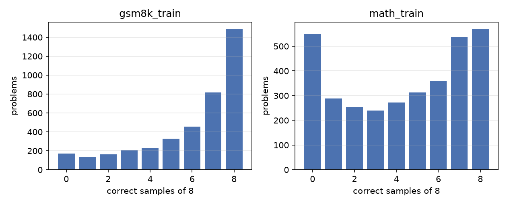

# Phase 3 report: rejection-sampling fine-tuning from the SFT checkpoint

Branch `phase-3-rft`. Code written 18 Oct 2026 (laptop); every run on the E2E TIR H100 SXM 80 GB
notebook on 19 Oct 2026 at commit bb6f2a6, in the same session as Phase 2 and right after it; the
gap-analysis runs (section 6) later the same day. Written up 19 Oct 2026. Numbers are greedy,
batch-invariant vLLM, 95 % bootstrap CIs over problems, paired on shared problem ids unless stated.
Pre-registration: `experiments.md` EXP-009, EXP-010, EXP-010b (and the post-hoc EXP-010c to
EXP-010f, whose decision rules were written before they ran).

## 1. Summary

One round of rejection-sampling fine-tuning (RFT) from the Phase 2 SFT checkpoint: sample 8 traces
per training problem at T = 1.0, keep the correct, finished, well-formed ones (at most two per
problem, shortest first), fine-tune one epoch at lr 5e-6. On the trained think-tag format, greedy,
RFT beats SFT by +3.3 [1.0, 5.8] on GSM8K, +3.0 on perturbed GSM8K, +5.8 [1.6, 10.2] on MATH-500
and +3.2 on Countdown (section 4). Three training seeds put the GSM8K gain at +4.6 (range 3.3-5.5,
every seed significant) and the MATH-500 gain at +4.3 (range 2.6-5.8, one seed's CI touching 0). A
control that trains the same number of tokens on the distilled data instead gains nothing
(GSM8K 74.8 -> 74.1, MATH-500 50.6 -> 49.2), so the gain is the selected self-generated data, not
the extra gradient steps. Most of the gain is the removal of non-terminating generations: truncation
falls from 28 % to 15 % on GSM8K and from 52 % to 40 % on MATH-500, and it is the same at an
8,192-token cap. Under sampling at T = 0.6 the residual gain is +2.3 / +2.8 at pass@1 and persists
to k = 32 on MATH-500; under the 4-shot-CoT template the pass@k curves of SFT and RFT coincide at
every k. No transfer to Countdown at any cap; the perturbation gap and the memorisation probe are
unchanged. Checkpoint: `Raviteja546/reasoning-rlvr-rft` (seeds 1 and 2 under `seeds/`).

## 2. EXP-009: the solve-rate distribution of the SFT policy on its training prompts

Pool as pre-registered: MATH-train levels 1-3 minus the dev split (3,388 problems) and a seeded
4,000-problem cap of GSM8K-train minus the dev split; n = 8, T = 1.0, top-p 1.0, think-tag prompt.
**Deviation:** the sampling ran at a 2,048-token cap although the cap rule chose 4,096 (the SFT
think-tag p90 is about 3,960): `rlvr-eval` treated a flag equal to its parser default as absent and
let the config's 2,048 win (fixed with a test on 19 Oct, commit 3e055ad). Nobody noticed until the
data step. The run was kept and trained on (section 7 says why); the consequence is that every
kept trace is under 2,048 tokens. 1 h 19 min, 95.6 M generated tokens, 19.5-21.6k tokens/s.

| split | problems | pass@1 (mean sample) | pass@8 | maj@8 | truncated | rate 0 | rate 1 | learnable (0 < rate < 1) | mean rate |
|---|---|---|---|---|---|---|---|---|---|
| GSM8K-train (pool 4,000) | 4,000 | 75.1 [73.8, 76.4] | 95.7 [95.0, 96.3] | 89.1 | 34.9 % | 173 (4.3 %) | 1,488 (37.2 %) | 2,339 (58.5 %) | 0.750 |
| MATH-train L1 | 548 | | | | | 36 (6.6 %) | 168 (30.7 %) | 344 (62.8 %) | 0.706 |
| MATH-train L2 | 1,304 | | | | | 163 (12.5 %) | 246 (18.9 %) | 895 (68.6 %) | 0.595 |
| MATH-train L3 | 1,536 | | | | | 352 (22.9 %) | 156 (10.2 %) | 1,028 (66.9 %) | 0.436 |
| MATH-train L1-3 | 3,388 | 54.2 [52.4, 56.0] | 83.7 [82.5, 84.9] | 78.8 | 59.5 % | 551 (16.3 %) | 570 (16.8 %) | 2,267 (66.9 %) | 0.541 |

Against the hypothesis: GSM8K-train is *not* saturated at this cap (37 % at 8 of 8 against "more
than half"; 4 % at 0 of 8 against "under 10 %", met); MATH levels 1-3 are not saturated as
hypothesised (17 % at 8 of 8 against "fewer than a third", 16 % at 0 of 8 inside the predicted
15-30 %). The learnable set is 2,267 MATH problems (predicted 1,500-2,500) and 2,339 GSM8K ones
(predicted 1,000-2,000). The falsifier (more than half of MATH levels 1-3 at rate 0) is far off at
6.6 / 12.5 / 22.9 %. The solve rate falls with level (0.71, 0.60, 0.44), as it should. The one
caveat is the cap: 35 % of GSM8K-train samples and 60 % of MATH-train samples were truncated at
2,048 tokens, so "rate" here means "solved within 2,048 tokens", and some rate-0 problems are
problems the model cannot finish in that budget rather than cannot solve. The learnable-prompt file
for Phase 4 (4,606 prompts, hash 281bdfe31176411b) and the per-problem solve rates are in the
session archive and on the node's disk (`outputs/data/rft/`); the manifest is committed as
`data/manifests/rft_iter1.json`.

**The kept set** (`phase-3-data.md`): 11,145 examples (6,956 GSM8K, 4,189 MATH), the shortest two
distinct correct traces per problem, content hash f44edf33a26c55fc, 13.45 M tokens (mean 1,207,
p90 1,779, max 2,529 prompt + completion). Drops: 20,438 incorrect, 18,709 over the per-problem
cap, 8,593 truncated, 14 with stray think tags, 5 malformed. Decontamination against every eval
set with the Phase 2 detectors dropped 200 items: 133 of them because 36 MATH-500 problems (7.2 %)
have a near-duplicate among the MATH-train prompts (the known train/test overlap of MATH; the Phase
2 set, drawn from OpenR1, had 3), 73 for 21 MATH-dev problems, 2 for one GSM8K problem. The RFT
checkpoint never trained on a trace of a flagged problem; the comparisons below are on the full
MATH-500, and the by-level table is where a reader would look for an effect of the 36.

## 3. The RFT run (EXP-010) and the two controls

| run | data | tokens | steps | backend | time | peak | loss |
|---|---|---|---|---|---|---|---|
| `rft_1p7b` (seed 0) | 11,145 kept self-generated traces | 13.45 M | 53 | flash-attn 2, packed, 4 x 16 | 11 min 53 s | 32.9 GB | 0.427 |
| `rft_1p7b_seed1`, `_seed2` | same set, seeds 1 and 2 | 13.45 M | 53 | flash-attn 2, packed, 8 x 8 | 11 min each | 38.8 GB | 0.428 / 0.428 |
| `sft_1p7b_control` (EXP-010b) | 11,145 distilled traces, seeded subset 1 of the SFT set | 29.84 M | 132 | flash-attn 2, packed, 8 x 8 | 26 min | 50.5 GB | 0.376 |
| `sft_1p7b_control_tok` (EXP-010e) | 5,000 distilled traces, seeded subset 1 | 13.37 M | 59 | flash-attn 2, packed, 8 x 8 | 12 min | 38.6 GB | 0.376 |

All from `outputs/train/sft_1p7b/final`, lr 5e-6, one epoch, cosine to 10 %, 3 % warmup, effective
batch 64, fp32 master weights under bf16 autocast. **Backend note:** the SFT checkpoint itself was
trained with sdpa and no packing (Phase 2 report, section 5); every Phase 3 run trained packed with
the flash-attention wheel built on the node that morning. The loss is the same function (the packed
and unpacked losses agree to 1e-4; Phase 2 engineering notes, section 4); the micro-batch composition
is not. The two controls share RFT's backend, so the causal comparisons of section 5 are
backend-matched; the SFT-versus-RFT comparison of section 4 is not, and carries that caveat.

**Deviation on the controls.** EXP-010b was pre-registered as "one more epoch from `sft` on a fresh
seeded slice of the OpenR1 set with as many examples as the RFT kept set". The session script set
`limit=11145, subset_seed=1` on the SFT training file, and that file *is* the 23,000 traces the SFT
checkpoint had already trained on for two epochs: `train_ids.json` of both controls is a subset of
the SFT run's. No fresh traces of the same quality exist (the Phase 2 funnel kept every correct,
single-answer, under-cap trace of the source, all 23,000 of them), so the pre-registration was not
runnable as written, and the code I wrote for it never checked. What ran is therefore "a third pass
over half of the seen distilled data" (example-matched) and "a third pass over 5,000 seen traces"
(token-matched). This is a weaker alternative than fresh data: it answers "is the RFT gain just more
gradient steps on the distilled distribution" and not "is it just more distilled data". Section 5
reads the controls that way.

## 4. RFT versus SFT, paired

**Think-tag, greedy, full sets** (`phase-3-compare-think_tag.md`):

| eval | pairs | SFT | RFT | RFT - SFT [paired CI] | only SFT / only RFT | truncated SFT / RFT | mean tokens SFT / RFT |
|---|---|---|---|---|---|---|---|
| GSM8K | 1319 | 74.8 [72.5, 77.1] | 78.2 [76.0, 80.3] | **+3.3 [1.0, 5.8]** | 101 / 145 | 28.1 / 15.2 % | 1,887 / 1,426 |
| GSM8K perturbed | 830 | 66.0 [62.8, 69.3] | 69.0 [65.8, 72.2] | **+3.0 [0.0, 5.9]** | 62 / 87 | 28.8 / 16.9 % | 1,930 / 1,530 |
| MATH-500 | 500 | 50.6 [46.4, 55.0] | 56.4 [52.0, 60.4] | **+5.8 [1.6, 10.2]** | 49 / 78 | 52.0 / 39.6 % | 2,910 / 2,601 |
| Countdown | 500 | 3.8 [2.2, 5.6] | 7.0 [4.8, 9.4] | **+3.2 [0.6, 6.0]** | 16 / 32 | 94.8 / 87.8 % | 3,835 / 3,654 |
| AIME24 | 30 | 3.3 [0.0, 10.0] | 0.0 | -3.3 [-10.0, 0.0] | 1 / 0 | 96.7 / 93.3 % | |

MATH-500 by level, RFT minus SFT: L1 +7.0 [-7.0, 18.6] (n 43), L2 -1.1 [-11.1, 8.9] (90), L3 +2.9
[-8.6, 14.3] (105), L4 +11.7 [2.3, 21.1] (128), L5 +6.7 [0.0, 13.4] (134). The hypothesis said the
gain would concentrate on levels 1-3, the levels the RFT data came from; it sits on levels 4-5
instead, with levels 1-3 inside their CIs. Post hoc, with n of 128-134 per level, this is a lead to
test, not a finding: the 2,048-cap selection kept short traces, and short traces may help most where
the SFT model rambles longest (level 4-5 truncation is where the SFT checkpoint is worst). Against
the base (`phase-3-compare-base-think_tag.md`): RFT minus base is +16.4 [13.5, 19.2] on GSM8K,
+17.6 on perturbed GSM8K, +11.6 [6.0, 16.6] on MATH-500, +5.8 on Countdown.

**Three seeds** (EXP-010d; `phase-3-compare-think_tag-seed{1,2}.md`, `-seed{1,2}-vs-seed0.md`):

| seed | GSM8K | GSM8K perturbed | MATH-500 | Countdown |
|---|---|---|---|---|
| 0 | +3.3 [1.0, 5.8] | +3.0 [0.0, 5.9] | +5.8 [1.6, 10.2] | +3.2 [0.6, 6.0] |
| 1 | +5.5 [3.2, 7.9] | +6.4 [3.6, 9.0] | +2.6 [-1.8, 7.0] | +1.8 [-0.6, 4.4] |
| 2 | +5.0 [2.7, 7.3] | +3.4 [0.5, 6.1] | +4.6 [0.4, 8.6] | +2.6 [0.2, 5.2] |
| mean (range) | **+4.6 (3.3 to 5.5)** | +4.3 (3.0 to 6.4) | **+4.3 (2.6 to 5.8)** | +2.5 (1.8 to 3.2) |

Seed to seed, paired: seed 1 minus seed 0 is +2.1 [0.1, 4.2] on GSM8K and -3.2 [-7.6, 1.2] on
MATH-500; seed 2 minus seed 0 is +1.7 [-0.4, 3.7] and -1.2 [-5.2, 2.8]. Every seed clears zero on
GSM8K and perturbed GSM8K, and the spread (2.2 and 3.4 points) is below the mean gain; on MATH-500
one seed's CI includes zero and the spread (3.2) is close to the gain. The seed-to-seed difference
of RFT training, up to 3 points, is the noise floor under every single-seed comparison in this
study, the SFT checkpoint's own seed included (one seed; not repeated, section 8).

**The other two templates, greedy, full sets** (`phase-3-compare-few_shot_cot.md`, `-zero_shot.md`):
4-shot-CoT -0.2 [-1.6, 1.2] on GSM8K, 0.0 on perturbed, -1.2 [-4.4, 1.8] on MATH-500; zero-shot
-1.1 [-2.7, 0.6], +2.0 [0.0, 4.1], +1.6 [-2.0, 5.2]. The gain lives in the trained format. Under
zero-shot the RFT checkpoint scores 81.1 / 74.7 / 64.8, still above its own think-tag rows (78.2 /
69.0 / 56.4): the format deficit of Phase 2 shrank by half and did not close.

**Perturbation gap** (think-tag, 830 pairs): original 78.2, perturbed 69.0, gap 9.2 points (SFT 11.3
[7.7, 14.7], base 10.4); within CI of unchanged, as hypothesised. The n = 64 version for RFT
(`phase-3-perturbation-gap-rft-n64.md`) has only 67 pairs, because `--limit 300` drew independent
subsets of the two sets (fixed on 19 Oct: a derived set's subset now follows its parent's); it is
reported for completeness and not read.

**Partial-prompt completion** (similarity 0.9): GSM8K 2.4 % [1.7, 3.4] (SFT 2.2, base 2.1),
MATH-500 14.3 % [11.4, 17.6] (SFT 14.1, base 16.3). Unchanged, as hypothesised: self-generated data
on decontaminated prompts added no recall.

## 5. Is it the data or the steps? The two controls

| eval | SFT | control (11,145 seen traces, 29.8 M tokens) | control_tok (5,000 seen traces, 13.4 M tokens) | RFT (13.4 M tokens) |
|---|---|---|---|---|
| GSM8K | 74.8 | 76.0 [73.8, 78.2] | 74.1 [71.9, 76.4] | 78.2 |
| GSM8K perturbed | 66.0 | 69.0 | 67.2 | 69.0 |
| MATH-500 | 50.6 | 50.2 [45.8, 54.6] | 49.2 [44.8, 53.4] | 56.4 |
| Countdown | 3.8 | 4.2 | 2.8 | 7.0 |
| truncation GSM8K / MATH-500 | 28 / 52 % | 25 / 51 % | 25 / 50 % | 15 / 40 % |

RFT minus control, paired (`phase-3-compare-control.md`): GSM8K +2.1 [-0.2, 4.3], perturbed 0.0
[-3.0, 2.9], MATH-500 **+6.2 [1.6, 10.6]**, Countdown +2.8 [0.2, 5.6]. RFT minus control_tok
(`phase-3-compare-control-tok.md`): GSM8K **+4.0 [1.7, 6.2]**, perturbed +1.8 [-1.1, 4.8], MATH-500
**+7.2 [2.6, 11.6]**, Countdown +4.2 [1.4, 6.8].

Reading. A third pass over the distilled traces moves the SFT checkpoint by about nothing (GSM8K
+1.2 and -0.7, MATH-500 -0.4 and -1.4) and leaves truncation where it was; the same number of tokens
of selected self-generated traces moves it by +4.0 and +7.2 and cuts truncation by 12-13 points. The
EXP-010b hypothesis (control gains less than RFT on MATH-500, CI excluding 0) is met with either
control; its falsifier (RFT minus control within one point on MATH-500) is far off. The
example-matched control saw 2.2x the tokens and came out slightly stronger on GSM8K (+1.2), which is
why that comparison's CI touches zero; at equal tokens it does not. What the controls cannot say,
because the fresh-data control was not runnable (section 3): whether *new* distilled traces of the
same quality would have done what the self-generated ones did. The honest claim is "the gain is not
more gradient steps on the distilled distribution"; "the on-policy data is the point" is the likely
reading and not a tested one.

## 6. Does RFT sharpen or add? pass@k in two formats, and the length story

**4-shot-CoT, n = 64, T = 0.6** (EXP-010's pre-registered curve; RFT sampled on seeded
300-problem subsets of each set to save 2.5 hours, paired with the full SFT samples on the shared
ids; `phase-3-compare-pass_at_k.md`, `figures/phase-3-pass-at-k-rft.png`):

| eval | pairs | k = 1 | k = 4 | k = 16 | k = 64 |
|---|---|---|---|---|---|
| GSM8K | 300 | -0.8 [-1.4, -0.1] | -0.1 | 0.0 | +0.3 [-0.7, 1.3] |
| GSM8K perturbed | 300 | +1.1 [0.4, 1.7] | +0.7 | +0.4 | +1.3 [-0.7, 3.3] |
| MATH-500 | 300 | +0.2 [-0.4, 0.9] | -0.4 | 0.0 | +0.3 [-2.0, 3.0] |
| AIME24 | 30 | +0.1 | +0.1 | +0.1 | +3.3 [0.0, 10.0] |

Under the template the model was not trained in, the curves coincide at every k: the pre-registered
"pass@64 moves by less than 2 points" holds, and so does the sampled pass@1 (within one point). The
new-versus-sharpened count: on MATH-500, 7 problems only RFT solves in 64 tries against 6 only SFT;
on GSM8K 2 against 1.

**Think-tag, n = 32, T = 0.6, top-p 0.95** (EXP-010f, the trained format, same 300-problem subsets;
`phase-3-compare-think_tag_n32_t06.md`):

| eval | k = 1 | k = 4 | k = 16 | k = 32 (both / only SFT / only RFT / neither) |
|---|---|---|---|---|
| GSM8K | SFT 80.3, RFT 82.6, **+2.3 [1.5, 3.2]** | +0.9 [0.3, 1.6] | +0.5 [-0.2, 1.4] | 98.3 vs 98.7 (294 / 1 / 2 / 3) |
| MATH-500 | SFT 58.8, RFT 61.6, **+2.8 [1.9, 3.7]** | +2.0 [1.0, 3.0] | +2.5 [0.9, 4.2] | 88.7 vs 90.7 (262 / 4 / 10 / 24) |

Truncation at T = 0.6: SFT 13.0 / 39.4 %, RFT 5.4 / 28.1 % (GSM8K / MATH-500); mean tokens 1,688 ->
1,281 and 2,850 -> 2,512. In the trained format the RFT curve sits above the SFT curve at every k:
on GSM8K both reach the 98-99 % ceiling by k = 16; on MATH-500 a +2.0-2.5 gain persists to k = 32,
with 10 problems only RFT solves against 4 only SFT. This is not "sharpening with lost diversity";
it is a uniform upward shift, consistent with fewer non-terminating generations rather than new
solutions (the few-shot curves, where neither model loops much, coincide).

**Temperature.** The greedy think-tag gain (+3.3 / +5.8) shrinks to +2.3 / +2.8 at T = 0.6 and
stays significant. The reason is in the SFT column: sampling already rescues most of the SFT
checkpoint's greedy loops (GSM8K 74.8 greedy -> 80.3 sampled pass@1, truncation 28 -> 13 %), so
there is less for RFT to fix. A reviewer's one-line version: the greedy RFT gain is mostly the
removal of degenerate loops; under sampling the residual gain is 2-3 points and real.

**The cap** (EXP-010c; greedy think-tag at an 8,192-token cap on the same subsets plus 300 Countdown
problems; `phase-3-compare-think_tag_8k.md`):

| set | SFT at 8k (truncated, mean tokens) | RFT at 8k | RFT - SFT | the 4k numbers on the full sets |
|---|---|---|---|---|
| GSM8K | 75.0 [70.0, 79.7] (27.0 %, 3,011) | 80.7 [76.0, 85.0] (14.0 %, 1,977) | +5.7 [0.7, 10.7] | 74.8 -> 78.2, truncation 28 -> 15 % |
| MATH-500 | 54.0 [48.3, 59.7] (46.3 %, 4,828) | 58.7 [53.0, 64.3] (36.0 %, 4,128) | +4.7 [-1.0, 10.3] | 50.6 -> 56.4, 52 -> 40 % |
| Countdown | 4.0 [2.0, 6.3] (95.3 %, 7,880) | 6.7 [4.0, 9.7] (88.7 %, 7,434) | +2.7 [-1.0, 6.3] | 3.8 -> 7.0, 95 -> 88 % |

Doubling the cap changes the accuracies by 0.2-3 points and leaves truncation where it was: the
truncated generations do not finish at 8,192 tokens either, they loop (Countdown's run to 7,880 on
average). The think-tag deficit of Phase 2 is therefore not a budget artefact, and the RFT gain is
the same at either cap. No transfer to Countdown at any cap (4-7 % for both, 89-95 % looping): the
hypothesis "Countdown stays within its CI" holds at 4k in the sense that nothing usable changed,
although the paired +3.2 clears zero.

## 7. Deviations and decisions, in one place

1. EXP-009 sampled at a 2,048-token cap (harness bug; fixed 19 Oct). Kept and trained on: the set
   was large and healthy, 2,048 is the plan's own default for shorter traces, and the cap only
   changes which correct traces are kept (the shorter ones, which is the direction RFT pushes
   anyway); a rerun at 4,096 would have cost about 2.7 H100-hours for a result that differs mainly
   in keeping longer traces. Reported as part of the method: "RFT on correct traces under 2,048
   tokens". The length-selection it implies is part of why truncation fell; a reader who wants the
   training effect separated from the selection effect needs EXP-010 at 4,096, which was not run.
2. EXP-010's n = 64 sampling ran on seeded 300-problem subsets (AIME24 whole), the user's call to
   save 2.5 hours; the paired CIs stay valid on the shared ids and are about 2x wider on GSM8K
   (uninformative at the ceiling anyway) and 1.3x wider on MATH-500.
3. The controls trained on seen distilled traces, not fresh ones (section 3). The pre-registration
   was not runnable from this data; recorded as a design error of the Phase 3 code.
4. RFT trained packed with flash attention while the SFT checkpoint trained unpacked with sdpa
   (section 3). The controls share RFT's backend.
5. The model card's `base_model` had to be the SFT Hub repo id, not the local path the run trained
   from; the Hub rejected the first upload (fixed in `push_to_hub.py`, 3e055ad).
6. The smoke step sampled at 512 tokens and found no correct trace (the SFT model needs 1,900+);
   the cap is now 2,048. The RFT Countdown n = 64 run and the second RFT iteration (EXP-011) were
   dropped before the session, as planned.
7. The five post-hoc runs of section 6 and section 4 (EXP-010c to EXP-010f and the two base rows
   of Phase 2) were chosen from a written gap analysis with a "result that would change the
   conclusion" per run before any of them started; they cost 4.0 H100-hours.

## 8. Compute

Phase 3 part of the H100 session: about 10.3 node-hours, INR 3,900, of the session's 28.1 h and
INR 10,640 (rows in `COMPUTE.md`). Core (smoke, EXP-009 sampling 1 h 19 min, build, RFT training
12 min, evals 22 min, control 39 min, the subset n = 64 sampling 1 h 22 min, report): 4.1 h, against
the plan's 4.5-7 A100-hours; the training steps came in far under their estimates because packed
4,096-token rows cover the kept set in 53 steps. The gap-analysis runs 4.0 h (G6, the n = 32
sampling, 2.2 h of it); the analysis itself 0.9 h of idle GPU; archive, uploads and prune about 1.3 h.
Generated tokens about 300 M, trained about 97 M. Rates measured for the next session: RFT-size
training 12 min; a five-set greedy think-tag eval 8-10 min; n = 8 sampling of 7,388 prompts at a
2,048 cap 1 h 19 min; n = 64 on 300-problem subsets of four sets 1 h 22 min.

## 9. What Phase 4 needs from here

- The start checkpoint. The EXP-010 falsifier did not fire, so by the plan's decision 6 Phase 4
  starts from `rft` (seed 0, `Raviteja546/reasoning-rlvr-rft`, the pre-registered run; the seeds
  are the noise floor, not candidates). Its dev-split think-tag accuracy was not measured on the
  node; if Phase 4 wants the formal rule applied, it costs one 3-minute eval per checkpoint.
- The learnable prompts (`outputs/data/rft/learnable_prompts.jsonl`, 4,606 prompts, hash
  281bdfe31176411b; on the node's disk and in the session archive) and the per-problem solve rates,
  with the caveat that "rate" was measured at a 2,048 cap.
- Two ablations that need code before they can run, both cheap on the H100: RFT without the
  correctness filter (same number of self-generated traces; is it selection or self-distillation?)
  and SFT without the think tags (is the format a cost at training time, not only at decoding?).
  The gap analysis priced them at about 20 minutes and 2 hours.
- The length lesson: a quarter of SFT generations and a sixth of RFT generations never terminate
  at greedy. Phase 4's reward must not pay for a correct answer that arrives after a loop, and its
  length statistics are results, not diagnostics.
